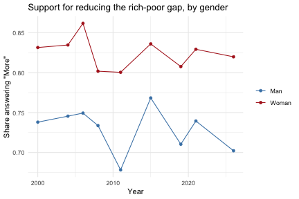

<!--
  cvpa.Rmd is GENERATED from cvpa.Rmd.orig -- edit the .orig, not cvpa.Rmd.
  The output below was computed against the live data, so the vignette builds
  offline (CRAN, pkgdown). Re-knit before each release and whenever the data
  changes, from the package root:
    devtools::load_all(); setwd("vignettes")
    knitr::knit("cvpa.Rmd.orig", "cvpa.Rmd")
-->


cvpa gives you weighted party support and policy-issue attitudes by
demographic group, over time, from Canadian public-opinion surveys going
back to 1945. As of version 0.2.0, that covers several hundred policy
questions across seven issue domains -- economy and taxation, energy and
environment, health/education/social programs, immigration/diversity/
federalism, foreign policy and identity, social issues/rights/justice, and
democracy and institutions -- in addition to vote choice and intention.
From cvpa's point of view, vote is just one more question: it's decoded and
analyzed the same way as any policy question.

## Two ways to use cvpa

There are two separate paths through the package, and it's worth being
clear about which one you're on:

* **The live data path** (`update_cvpa_data()`, `question_catalog()`,
  `question_data()`, `wtd_response()`, `response_gap_analysis()`) reads
  Parquet files hosted alongside the [policy-attitudes web
  app](https://policyattitudes.ca/app/), covering every
  question in the catalog. This is almost certainly what you want for new
  analysis.
* **The legacy vote path** (`vote_data`, `wtd_vote()`, `gap_analysis()`)
  is the original vote-choice/intention dataset and functions the package
  shipped with before 0.2.0, kept as-is for reproducing prior work (in
  particular Lucas, Romualdi, Armstrong, and Goodyear-Grant's *Canadian
  Journal of Political Science* piece on the Canadian Vote Intention
  Dataset). `wtd_vote()`/`gap_analysis()` are, under the hood, thin
  wrappers around the same general engine that powers the live data path,
  so their behavior hasn't changed -- see the last section of this
  vignette.

This vignette focuses on the live data path, since that's what's new.


``` r
library(cvpa)
```

## Setting up the local cache

cvpa doesn't bundle policy-attitude data in the package itself -- there's
too much of it, and it's updated periodically as new survey waves are
added. Instead, `update_cvpa_data()` downloads what you ask for into a
local cache (see `cvpa_cache_dir()`) the first time you need it, and every
other function reads only from that cache. Nothing in the package other
than `update_cvpa_data()` ever touches the network, so you're always in
control of when a download happens.

The question catalog and the demographic/party code-labels table are small
and are always refreshed by `update_cvpa_data()`. Respondent-level data for
a specific question is only fetched when you name it (there are several
hundred questions, so there's deliberately no "fetch everything" option --
the full dataset is available as `dataset.parquet` from the
[cvpa_dataset repository](https://github.com/lucasjacklucas/cvpa_dataset)):


``` r
update_cvpa_data(questions = "bri_econ_013")
#> Fetching question catalog (vbl_data.parquet)...
#> Fetching code labels (code_labels.parquet)...
#> Fetching 1 question file(s)...
#>   [1/1] bri_econ_013
```


## Finding a question

`question_catalog()` lists every available question, one row per question,
deduplicated across the several hundred survey waves each question has
accumulated over the decades:


``` r
head(question_catalog(domain = "econ"), 10)
#>        question domain         domain_label                       issue_label
#> 1  env_econ_061   econ Economy and Taxation    Agree free trade Can-US-Mexico
#> 2  env_econ_074   econ Economy and Taxation        Appr cutting federal taxes
#> 3  env_econ_056   econ Economy and Taxation  Appr fed govt: deficit reduction
#> 4  env_econ_057   econ Economy and Taxation           Appr fed govt: taxation
#> 5  env_econ_060   econ Economy and Taxation       Appr prov govt: agriculture
#> 6  env_econ_075   econ Economy and Taxation Appr prov govt: deficit reduction
#> 7  env_econ_049   econ Economy and Taxation  Appr prov govt: econ development
#> 8  env_econ_046   econ Economy and Taxation     Appr prov govt: privatization
#> 9  env_econ_073   econ Economy and Taxation          Appr prov govt: taxation
#> 10 env_econ_058   econ Economy and Taxation                       Approve GST
#>                                                                                                                                                       question_wording
#> 1                                                                        Do you agree or disagree that there should be free trade between Canada, the U.S. and Mexico?
#> 2                                                                                             Do you approve or disapprove of the federal government making a tax cut?
#> 3                                                                Do you approve or disapprove of the way the current federal government is handling deficit reduction?
#> 4                                                     Generally speaking, do you approve or disapprove of the way the current federal government is handling taxation?
#> 5                                                              Do you approve or disapprove of the way your provincial government is handling agriculture and farming?
#> 6                                        Generally speaking, do you approve or disapprove of the way your current provincial government is handling deficit reduction?
#> 7                                     Generally speaking, do you approve or disapprove of the way your current provincial government is handling economic development?
#> 8                                                                Do you approve or disapprove of the way your current provincial government is handling privatization?
#> 9                                                 Generally speaking, do you approve or disapprove of the way your current provincial government is handling taxation?
#> 10 As you may know, the federal government has a tax on most goods and services, known as the Goods and Services Tax or GST. Do you approve or disapprove of this tax?
#>    n_waves type        value_labels
#> 1        9    b     Disagree, Agree
#> 2        9    b Disapprove, Approve
#> 3       10    b Disapprove, Approve
#> 4       10    b Disapprove, Approve
#> 5       25    b Disapprove, Approve
#> 6        1    b Disapprove, Approve
#> 7       17    b Disapprove, Approve
#> 8        5    b Disapprove, Approve
#> 9       35    b Disapprove, Approve
#> 10       9    b Disapprove, Approve
```

`domain` and `type` (`"b"` for binary questions, `"lsm"` for 3-point
less/same/more-style questions, `"nsa"` for 3-point never/sometimes/always-
style questions, or `"party"` for vote choice/intention) both filter the
catalog if you want to narrow it down. With no arguments, `question_catalog()`
returns everything, vote included:


``` r
nrow(question_catalog())
#> [1] 630
table(question_catalog()$domain)
#> 
#> dpin econ ener hwps idim intd soim vote 
#>   34  139   57   85  118   72  123    2
```

Once you've picked a question, `question_response_labels()` shows you what
its response categories actually are and how they're coded:


``` r
question_response_labels("bri_econ_013")
#>   code label sort_order
#> 1   -1  Less          1
#> 2    0  Same          2
#> 3    1  More          3
```

## Fetching and inspecting a question's data

`question_data()` reads the (now cached) respondent-level data for one
question and, by default, decodes both the response and every demographic
column into labeled factors:


``` r
d <- question_data("bri_econ_013")
head(d)
#> # A data frame: 6 × 18
#>   response_id  survey_id response weight  year vote_intention vote_choice region
#> * <chr>        <chr>     <fct>     <dbl> <dbl> <fct>          <fct>       <fct> 
#> 1 CES2015_Com… 2015.dta  More      0.835  2015 Undecided      PC/Conserv… Ontar…
#> 2 2019+Canadi… 2019.dta  Less      1.35   2019 PC/Conservati… <NA>        Prair…
#> 3 2021 Canadi… 2021.dta  More      0.546  2021 Liberal        Bloc Quebe… Quebec
#> 4 ces2004-6-8… 2008.dta  Same      1.31   2008 <NA>           Green       Prair…
#> 5 2021 Canadi… 2021.dta  Same      0.631  2021 PC/Conservati… PC/Conserv… Prair…
#> 6 2021 Canadi… 2021.dta  Less      1.94   2021 PC/Conservati… PC/Conserv… Prair…
#> # ℹ 10 more variables: province <fct>, com_500 <fct>, com_100 <fct>,
#> #   gender <fct>, age_cats <fct>, religion <fct>, degree <fct>, language <fct>,
#> #   union_household <fct>, occupation <fct>
```

Every question's data has the same shape: `response`, `weight`, `year`,
plus the demographic and vote columns listed in `cvpa_grouping_vars` --
see `demographic_vars` for what each demographic variable measures and
what categories it takes:


``` r
cvpa_grouping_vars
#>  [1] "vote_intention"  "vote_choice"     "region"          "province"       
#>  [5] "com_500"         "com_100"         "gender"          "age_cats"       
#>  [9] "religion"        "degree"          "language"        "union_household"
#> [13] "occupation"
demographic_vars
#>           variable
#> 1           region
#> 2         province
#> 3          com_500
#> 4          com_100
#> 5           gender
#> 6         age_cats
#> 7         religion
#> 8           degree
#> 9         language
#> 10 union_household
#> 11      occupation
#>                                                                                                                                                                                                                                              description
#> 1                                                                                                                                                                                                                                    Region of residence
#> 2                                                                                                                                                                                                                     Province or territory of residence
#> 3                                                                                                                                                                                                            Community size, split at 500,000 population
#> 4                                                                                                                                                                                                            Community size, split at 100,000 population
#> 5  Respondent gender. Binary Man/Woman only -- a non-binary/other response option exists in some surveys from 2019 onward but is too sparse to include here; see the Canadian Opinion Research Archive (https://www.queensu.ca/cora/) for the full data.
#> 6                                                                                                                                                                                                                                           Age category
#> 7                                                                                                                                                                                                                                  Religious affiliation
#> 8                                                                                                                                                                                                                           University degree attainment
#> 9                                                                                                                                                                                                                                        Language spoken
#> 10                                                                                                                                                                                                                     Union membership in the household
#> 11                                                                                                                                                                                                                               Respondent's occupation
#>                                                                                                                                   categories
#> 1                                                                               Atlantic; Quebec; Ontario; Prairies; British Columbia; North
#> 2                                                                                        NL; PEI; NS; NB; QC; ON; MB; SK; AB; BC; YT; NT; NU
#> 3                                                                                                      Population <= 500k; Population > 500k
#> 4                                                                                                      Population <= 100k; Population > 100k
#> 5                                                                                                                                 Man; Woman
#> 6                                                                                                                          18-29; 30-49; 50+
#> 7                                                                                                  Catholic; Protestant; Jewish; Other; None
#> 8                                                                                                    No University Degree; University Degree
#> 9                                                                                                 French; English; French and English; Other
#> 10                                                                                   No Union Member in Household; Union Member in Household
#> 11 Managers, Executives; Professional; Routine Non-manual; Working Class; Armed Forces; Farmer/Fiserman; Retired; Unemployed; Student; Other
```

Notice that `vote_intention` and `vote_choice` are in that list alongside
the demographics -- every question's data carries how each respondent
voted, so you can group any policy question by vote just as easily as by
gender or region.

## Weighted response shares over time

`wtd_response()` computes each response category's weighted share of the
total, for every year (and, optionally, grouping-variable combination):


``` r
wtd_response(d, grouping_vars = "gender")
#> # A tibble: 54 × 5
#>     year response gender  count response_share
#>    <dbl> <fct>    <fct>   <dbl>          <dbl>
#>  1  2000 Less     Man     118.          0.0715
#>  2  2000 Less     Woman    63.5         0.0374
#>  3  2000 Same     Man     315.          0.191 
#>  4  2000 Same     Woman   222.          0.131 
#>  5  2000 More     Man    1218.          0.738 
#>  6  2000 More     Woman  1411.          0.832 
#>  7  2004 Less     Man     134.          0.0675
#>  8  2004 Less     Woman    63.5         0.0309
#>  9  2004 Same     Man     372.          0.187 
#> 10  2004 Same     Woman   276.          0.134 
#> # ℹ 44 more rows
```

A quick look at how the "More" category (support for reducing the
rich-poor gap) has moved over time, by gender:


``` r
library(ggplot2)
more_by_year <- subset(wtd_response(d, grouping_vars = "gender"), response == "More")
ggplot(more_by_year, aes(x = year, y = response_share, color = gender)) +
  geom_line() +
  geom_point() +
  scale_color_manual(values = c(Man = "steelblue", Woman = "firebrick")) +
  labs(
    x = "Year", y = "Share answering \"More\"",
    title = "Support for reducing the rich-poor gap, by gender",
    color = NULL
  ) +
  theme_minimal()
```



## Testing whether a gap is significant

`response_gap_analysis()` generalizes `gap_analysis()` to any question: a
difference-of-proportions test between two levels of a grouping variable,
for each response category, for each year:


``` r
response_gap_analysis(d, grouping_var = "gender")
#> # A tibble: 27 × 13
#> # Groups:   year [9]
#>     year response cnt_Man cnt_Woman n_Man n_Woman flag       estimate1 estimate2
#>    <dbl> <fct>      <dbl>     <dbl> <dbl>   <dbl> <chr>          <dbl>     <dbl>
#>  1  2000 Less       118.       63.5 1651.   1697. p-val rel…    0.0715    0.0374
#>  2  2000 Same       315.      222.  1651.   1697. p-val rel…    0.191     0.131 
#>  3  2000 More      1218.     1411.  1651.   1697. p-val rel…    0.738     0.832 
#>  4  2004 Less       134.       63.5 1991.   2054. p-val rel…    0.0675    0.0309
#>  5  2004 Same       372.      276.  1991.   2054. p-val rel…    0.187     0.134 
#>  6  2004 More      1485.     1714.  1991.   2054. p-val rel…    0.745     0.835 
#>  7  2006 Less        62.5      19.6  956.    914. p-val rel…    0.0653    0.0215
#>  8  2006 Same       177.      107.   956.    914. p-val rel…    0.185     0.117 
#>  9  2006 More       716.      788.   956.    914. p-val rel…    0.749     0.862 
#> 10  2008 Less        94.0      61.8 1609.   1665. p-val rel…    0.0584    0.0371
#> # ℹ 17 more rows
#> # ℹ 4 more variables: p.value <dbl>, conf.low <dbl>, conf.high <dbl>,
#> #   diff <dbl>
```

The `flag` column tells you whether every cell going into that year's test
had an expected count above 5 (`"p-val reliable"`) or not
(`"p-val unreliable"`) -- see `make_flag()`.

## Vote is just another question

Because vote choice and intention live in the same catalog and the same
`resp/question=<code>/data_0.parquet` layout as every policy question,
everything above works identically for `"vote_choice"`/`"vote_intention"`:


``` r
update_cvpa_data(questions = "vote_choice")
#> Fetching question catalog (vbl_data.parquet)...
#> Fetching code labels (code_labels.parquet)...
#> Fetching 1 question file(s)...
#>   [1/1] vote_choice
vc <- question_data("vote_choice", years = 2000:2021)
wtd_response(vc, grouping_vars = "gender")
#> # A tibble: 120 × 5
#>     year response        gender count response_share
#>    <dbl> <fct>           <fct>  <dbl>          <dbl>
#>  1  2000 Liberal         Man    1218.         0.415 
#>  2  2000 Liberal         Woman  1365.         0.456 
#>  3  2000 PC/Conservative Man     408.         0.139 
#>  4  2000 PC/Conservative Woman   414.         0.138 
#>  5  2000 CCF/NDP         Man     265.         0.0904
#>  6  2000 CCF/NDP         Woman   339.         0.113 
#>  7  2000 Bloc Quebecois  Man     304.         0.104 
#>  8  2000 Bloc Quebecois  Woman   298.         0.0997
#>  9  2000 Reform/Alliance Man     670.         0.228 
#> 10  2000 Reform/Alliance Woman   520.         0.174 
#> # ℹ 110 more rows
```

## The legacy vote path

If you're working with the original `vote_data` dataset -- for instance to
reproduce results from the CJPS piece it was built for -- `wtd_vote()` and
`gap_analysis()` are unchanged:


``` r
data(vote_data)
wtd_vote(vote_data, "intention", years = 2000:2022, grouping_vars = "gender")
#> The following years are not available: 2012, 2013, 2014, 2016, 2017, 2018
#> # A tibble: 200 × 5
#>     year vote           gender  count party_support
#>    <dbl> <fct>          <fct>   <dbl>         <dbl>
#>  1  2000 Liberal        Man    5357.        0.451  
#>  2  2000 Liberal        Woman  5318.        0.483  
#>  3  2000 Conservative   Man    1263.        0.106  
#>  4  2000 Conservative   Woman  1247.        0.113  
#>  5  2000 NDP            Man    1045.        0.0880 
#>  6  2000 NDP            Woman  1146.        0.104  
#>  7  2000 Social Credit  Man      80.9       0.00681
#>  8  2000 Social Credit  Woman    59.4       0.00539
#>  9  2000 Bloc Quebecois Man    1041.        0.0876 
#> 10  2000 Bloc Quebecois Woman   942.        0.0855 
#> # ℹ 190 more rows
gap_analysis(vote_data, "intention", years = 2000:2022, grouping_var = "gender")
#> The following years are not available: 2012, 2013, 2014, 2016, 2017, 2018
#> # A tibble: 93 × 13
#> # Groups:   year [16]
#>     year vote         cnt_Man cnt_Woman  n_Man n_Woman flag  estimate1 estimate2
#>    <dbl> <fct>          <dbl>     <dbl>  <dbl>   <dbl> <chr>     <dbl>     <dbl>
#>  1  2000 Liberal       5357.     5318.  11883.  11012. p-va…   0.451     0.483  
#>  2  2000 Conservative  1263.     1247.  11883.  11012. p-va…   0.106     0.113  
#>  3  2000 NDP           1045.     1146.  11883.  11012. p-va…   0.0880    0.104  
#>  4  2000 Social Cred…    80.9      59.4 11883.  11012. p-va…   0.00681   0.00539
#>  5  2000 Bloc Quebec…  1041.      942.  11883.  11012. p-va…   0.0876    0.0855 
#>  6  2000 Reform/Alli…  2742.     2008.  11883.  11012. p-va…   0.231     0.182  
#>  7  2000 Other          353.      292.  11883.  11012. p-va…   0.0297    0.0265 
#>  8  2001 Liberal       1426.     1598.   3315.   3361. p-va…   0.430     0.476  
#>  9  2001 Conservative   581.      525.   3315.   3361. p-va…   0.175     0.156  
#> 10  2001 NDP            332.      377.   3315.   3361. p-va…   0.100     0.112  
#> # ℹ 83 more rows
#> # ℹ 4 more variables: p.value <dbl>, conf.low <dbl>, conf.high <dbl>,
#> #   diff <dbl>
```

Note that `vote_data` predates the cp3 Parquet pipeline and has a single
`community_size` column rather than the live data path's `com_100`/`com_500`
split -- see `demographic_vars` for the live path's version of each
demographic variable.
